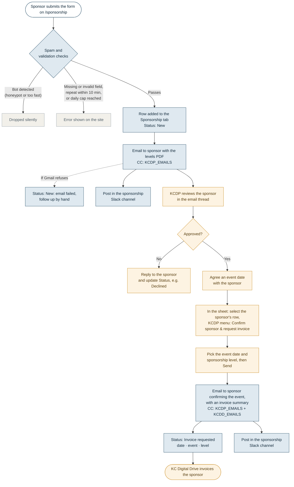
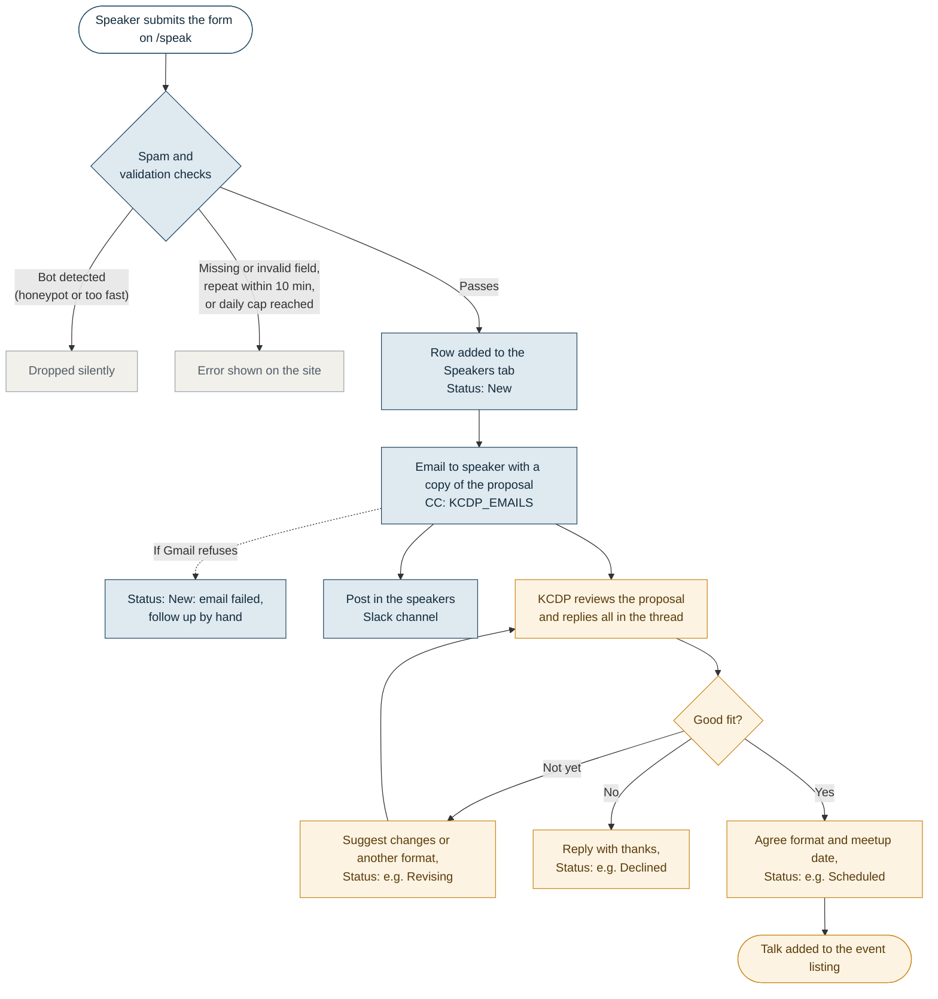

# Sponsorship and speaker forms

The forms on `/sponsorship` and `/speak` work without moving the site off GitHub Pages and cost nothing to run.

```
Visitor fills in the form on kcdataprofessionals.org (GitHub Pages)
        │  POST
        ▼
Google Apps Script web app  (apps-script/Code.gs, runs as the KCDP Google account)
        ├─ checks the answers and filters spam
        ├─ appends a row to a Google Sheet  ← the team's review "database"
        ├─ emails the submitter, with the KCDP organizers on CC
        │    (sponsorship emails attach the sponsorship levels PDF)
        └─ posts in Slack: #sponsorship or #speakers channel (optional)

KCDP approves the sponsor and sets an event date (in the email thread)
        │
Confirm sponsor & request invoice (spreadsheet's KCDP menu)
        └─ emails the sponsor with KCDP and KC Digital Drive on CC
           so KCDD can invoice; updates the row's Status
```

- **Storage:** a Google Sheet with one tab per form (`Sponsorship`, `Speakers`). Each row has a `Status` column (starts as `New`) and a blank `Team notes` column for tracking follow-up.
- **Email:** sent as "Kansas City Data Professionals". The submitter is on To and the people below are on CC. Reply-To is the first `KCDP_EMAILS` address, so "Reply all" keeps everyone in the thread.
  - **Speaker proposals and new sponsor inquiries** copy the KCDP organizers (`KCDP_EMAILS`).
  - **Invoicing** is the only email that copies KC Digital Drive (`KCDD_EMAILS`). KCDP reviews and approves each sponsor in the inquiry email thread and agrees an event date. Then, in the sheet:
    1. Click any cell in the sponsor's row on the `Sponsorship` tab.
    2. Choose **KCDP → Confirm sponsor & request invoice**. The menu appears a few seconds after the sheet opens; reload the sheet if it's missing.
    3. In the dialog, pick the **event date** from the date picker and the **sponsorship level** from the dropdown. The dialog also shows who will be emailed. Click **Send**.
    4. The sponsor gets an email confirming the event, with KCDP and KC Digital Drive copied and a summary KCDD can invoice from (organization, contact, event, level, website). The row's Status changes to `Invoice requested <today> · <event date> · <level>`.
  - Form emails come from the account that deployed the script. Invoicing emails come from whoever clicks the menu item, and each organizer approves Google's permission prompt the first time they use it.
- **Slack (optional):** each form posts to its own channel through a Slack incoming webhook. New sponsor inquiries and invoice requests go to the sponsorship channel; new talk proposals go to the speakers channel. Posts include the submitter's name and email, so use private channels. If Slack is unavailable, the submission still saves and emails as normal.
- **Cost and limits:** free. A personal Gmail account can send to about 100 recipients a day through Apps Script (each email counts the submitter plus every CC), so with up to three people copied (four recipients per email) the script accepts at most 20 submissions a day by default (`DAILY_LIMIT`). A Google Workspace account allows far more if you ever need it.
- **Spam and abuse:** a hidden honeypot field, a minimum fill time, one submission per email address per form every 10 minutes, and the daily cap. Values that look like spreadsheet formulas are stored as text.

## Workflows

Blue steps happen automatically, orange steps are done by a KCDP organizer, and white steps are the sponsor or speaker.

### Sponsorship form



### Speaker form



KC Digital Drive (`KCDD_EMAILS`) only appears in the sponsorship invoicing step. Status values other than `New`, `New: email failed…` and `Invoice requested…` are suggestions; type whatever suits the team, or add a dropdown to the Status column.

## One-time setup (about 15 minutes)

Use the shared KCDP Google account if there is one, so the forms don't depend on one person's account.

1. **Create the sheet.** In Google Drive, create a spreadsheet named `KCDP website submissions`. Share it with the other organizers.
2. **Add the script.** In the sheet, open **Extensions → Apps Script**. Replace the contents of `Code.gs` with [`apps-script/Code.gs`](../apps-script/Code.gs). Under **Project Settings**, tick **Show "appsscript.json" manifest file in editor**, then replace that file's contents with [`apps-script/appsscript.json`](../apps-script/appsscript.json).
3. **Upload the sponsorship levels document** to Drive (a Google Doc or a PDF). Open it and copy its file ID from the URL: the long string between `/d/` and `/edit` (or `/view`).
4. **Set the script properties.** In Apps Script, go to **Project Settings → Script properties** and add:

   | Property | Value |
   | --- | --- |
   | `KCDP_EMAILS` | KCDP organizers, comma-separated. Copied on every form email; the first address is the Reply-To. |
   | `KCDD_EMAILS` | KC Digital Drive contacts, comma-separated. Copied only on the invoicing email. |
   | `SPONSOR_LEVELS` | Choices for the invoicing dropdown, separated by semicolons, with prices as they appear in the levels document, e.g. `Bronze $250; Silver $500; Gold $1,000`. Defaults to `Bronze; Silver; Gold`. |
   | `SLACK_SPONSORSHIP_WEBHOOK_URL` | Optional. Webhook URL for the sponsorship Slack channel (see below). |
   | `SLACK_SPEAKERS_WEBHOOK_URL` | Optional. Webhook URL for the speakers Slack channel. |
   | `SPONSOR_DOC_ID` | The file ID from step 3 |
   | `DAILY_LIMIT` | Optional; defaults to `20`. Keep (recipients per email × limit) under 100 on a personal Gmail account. |

   These stay in the Google project, so nobody's email address appears in this public repository.
5. **Deploy.** Click **Deploy → New deployment**, choose type **Web app**, set *Execute as* **Me** and *Who has access* **Anyone**, and click **Deploy**. Approve the permissions prompt (Google will warn that the app is unverified, which is expected for your own script: **Advanced → Go to project**). Copy the **Web app URL**; it ends in `/exec`.
6. **Connect the site.** In `_config.yml`, paste the URL into `forms.endpoint`, then commit and merge. Until this is set, both forms show a notice and their Send buttons are disabled.
7. **Test it.** Submit each form once with your own email address. Check that a row appears in the sheet, both emails copy only the `KCDP_EMAILS` addresses, and the sponsorship email has the PDF attached. Then select the test sponsor's row, choose **KCDP → Confirm sponsor & request invoice**, and check that the invoicing email also copies the `KCDD_EMAILS` addresses. If you set up Slack, check that each step posted in the right channel. (Use your own addresses in both properties while testing so KC Digital Drive doesn't get a test email.)

## Slack channels (optional)

Create one private channel per workflow (for example `#kcdp-sponsorships` and `#kcdp-speakers`), then one Slack app with a webhook for each:

1. Go to <https://api.slack.com/apps>, click **Create New App → From scratch**, name it `KCDP Website Forms`, pick the KCDP workspace, and click **Create App**.
2. Under **OAuth & Permissions → Scopes → Bot Token Scopes**, add **`incoming-webhook`** if it isn't already listed. No other scopes or events are needed.
3. Under **Incoming Webhooks**, turn **Activate Incoming Webhooks** on, click **Add New Webhook**, pick the sponsorship channel, and click **Allow**.
4. Click **Add New Webhook** again and pick the speakers channel.
5. Copy each URL from **Webhook URLs for Your Workspace** into the matching script property: `SLACK_SPONSORSHIP_WEBHOOK_URL` and `SLACK_SPEAKERS_WEBHOOK_URL`.

You must be a member of a private channel for it to appear in the picker. Treat webhook URLs like passwords; if one leaks, delete it under **Incoming Webhooks** and add a new one. Leave a property empty to turn that channel's posts off.

## Changing things later

- **Sponsorship levels or prices:** edit `SPONSOR_LEVELS` in Script properties when the levels document changes. No redeploy needed.
- **Who gets copied:** edit `KCDP_EMAILS` or `KCDD_EMAILS` in Script properties. No redeploy needed.
- **The sponsorship levels document:** upload the new file and update `SPONSOR_DOC_ID`, or edit the existing Google Doc in place (the email always attaches its current version).
- **Email wording or form fields:** edit `apps-script/Code.gs` in this repo, run the tests, paste the file into the Apps Script editor, then **Deploy → Manage deployments → Edit → Version: New version → Deploy**. Editing the existing deployment keeps the same URL. A field added to the site's form must also be added to `FORMS` in `Code.gs`, or it won't be saved.
- **Tests:** `node --test apps-script/code.test.js` runs the script against fake Google services (no Google account needed).

## If something goes wrong

- **Status says `New: email failed, follow up by hand`:** the row was saved but Gmail refused the email (usually the daily quota). Reply to the person manually.
- **"Something went wrong" on the site:** open the Apps Script project's **Executions** page to see the error. A missing `KCDP_EMAILS` property is the most common cause.
- **The site still says submissions aren't switched on:** `forms.endpoint` in `_config.yml` is empty, or the change hasn't been deployed to GitHub Pages yet.
